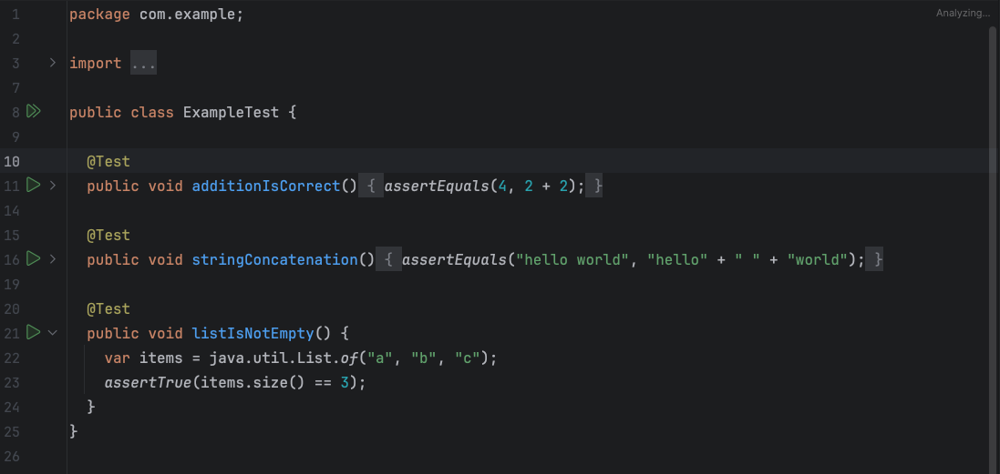
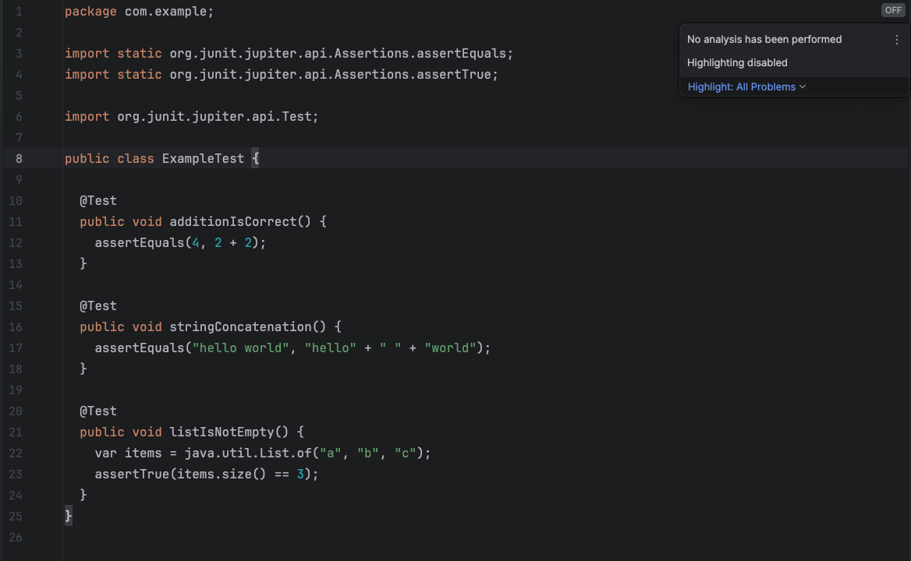

# bazel-examples

Minimal Bazel repo for reproducing IntelliJ Bazel plugin regressions in 2026.1.

## Issues

1. **No analysis / highlighting disabled** - The editor shows "No analysis has been performed" and "Highlighting disabled" for Java test files.
2. **No per-test run gutters** - Individual test play buttons are missing from the gutter; only "Run all tests" is available from the context menu.

## Steps to reproduce

1. Open this project in IntelliJ 2026.1 with the Bazel plugin
2. Sync the project
3. Open `java/src/test/java/com/example/ExampleTest.java`

## Expected (IntelliJ 2025.3)

Syntax highlighting works, analysis runs, and each `@Test` method has a play button in the gutter:

## Actual (IntelliJ 2026.1)

No analysis is performed, highlighting is disabled, and no per-test run gutters appear:

