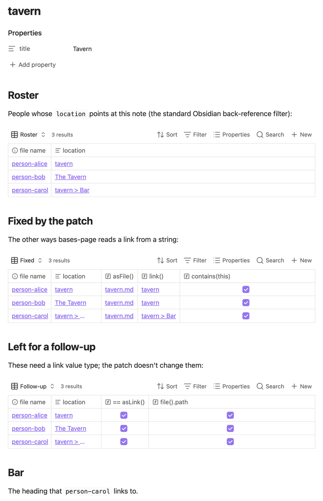
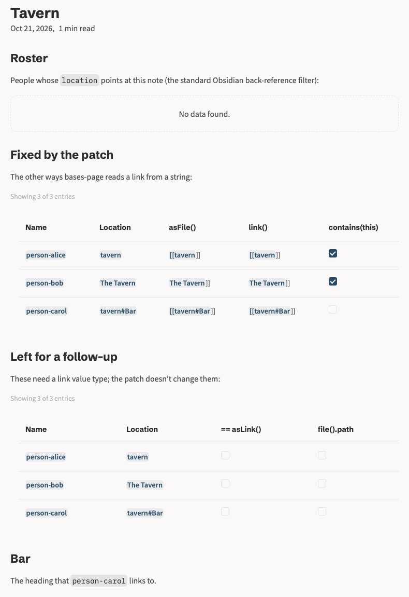
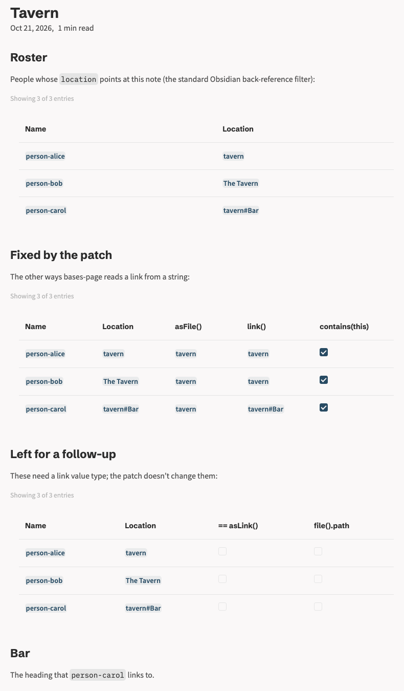

# bases-page: wikilink-valued frontmatter doesn't resolve

A minimal repro for [quartz-community/bases-page](https://github.com/quartz-community/bases-page) v1.0.0 (= `main` at `5c729d1`).

Obsidian stores link-valued frontmatter with the wikilink syntax intact (`location: "[[tavern]]"`). bases-page treats that as a plain string, and each function that reads a link from it gets it wrong in its own way:

1. `location.asFile()` looks up `[[tavern]]` literally and misses, so the usual "notes that point at this note" filter, `location.asFile().path == this.file.path`, shows **"No data found."**
2. `location.asFile().asLink()` and `link(location)` double-wrap to `[[[[tavern]]]]` and render as **broken links**.
3. `list(location).contains(this)` is `false` for a heading link like `[[tavern#Bar]]`.

All of these work in Obsidian. The fix for them is on [`vinnybod/bases-page@vinnybod/asfile-wikilinks`](https://github.com/vinnybod/bases-page/tree/vinnybod/asfile-wikilinks). Two more routes (`==` against a link, and `file()`) also differ from Obsidian but need a bigger change; the page shows them separately.

## Obsidian vs Quartz

The same vault in Obsidian 1.13.7 and in a Quartz v5 build, before and after the patch. Each table has a row per person: Alice links `[[tavern]]`, Bob `[[tavern|The Tavern]]` and Carol `[[tavern#Bar]]`.

| Obsidian (expected) | Quartz, bases-page v1.0.0 | Quartz, with the patch |
| :---: | :---: | :---: |
|  |  |  |
| Roster lists all three; every route resolves to the tavern note | Roster is empty; `asFile()` and `link()` render stray `]]`; Carol's `contains(this)` is unticked | Roster and every fixed route match Obsidian; the follow-up table is unchanged ([before](evidence/tavern.before.html) / [after](evidence/tavern.after.html) HTML) |

## Run it

Needs Node ≥ 22.13 (Quartz requires npm ≥ 10.9.2) and git. Nix users: `nix develop` (or direnv) provides Node 24.

```console
$ ./repro.mjs
...
public/tavern.html, compared with Obsidian:
  FAIL Roster filter   No data found
  FAIL asFile()        person-alice: [[[[tavern]]]]; person-bob: [[[[tavern|The Tavern]]]]; person-carol: [[[[tavern#Bar]]]]
  FAIL link()          person-alice: [[[[tavern]]]]; person-bob: [[[[tavern|The Tavern]]]]; person-carol: [[[[tavern#Bar]]]]
  FAIL contains(this)  person-carol: false
  --   == asLink()     false, false, false (Obsidian: true; left for a follow-up)
  --   file().path     false, false, false (Obsidian: true; left for a follow-up)
FAIL: wikilink-valued location is not resolved like Obsidian does

$ ./repro.mjs --patched
...
public/tavern.html, compared with Obsidian:
  ok   Roster filter   person-alice, person-bob, person-carol
  ok   asFile()        matches Obsidian
  ok   link()          matches Obsidian
  ok   contains(this)  matches Obsidian
  --   == asLink()     false, false, false (Obsidian: true; left for a follow-up)
  --   file().path     false, false, false (Obsidian: true; left for a follow-up)
PASS: every fixed route matches Obsidian
```

The expected values are what Obsidian shows in the screenshot above, except the two follow-up routes, which must stay `false` as in v1.0.0. PASS exits 0 and FAIL exits 1. Anything else (network, a failed plugin build, missing output) prints an error and exits 2, so a broken setup never reads as a verdict.

Add `--serve` to either and open <http://localhost:8080/tavern> to see it in a browser.

[`repro.mjs`](repro.mjs) fetches Quartz (v5 branch, pinned commit) into `.quartz/`, uses Quartz's default config with bases-page sourced from git at the commit in [`quartz.lock.json`](quartz.lock.json), builds [`content/`](content) into `public/`, and checks each base's cells in `public/tavern.html`. Each run resets both Quartz and the plugin to their pinned commits (fetching only what's missing); `--patched` then applies [`patches/bases-page-asfile-wikilinks.patch`](patches/bases-page-asfile-wikilinks.patch) before the plugin is rebuilt.

## The content

[`content/tavern.md`](content/tavern.md) has three inline bases, all over the notes with a `location`:

| Base | Columns |
| --- | --- |
| Roster | filtered by `location.asFile().path == this.file.path` |
| Fixed by the patch | `location.asFile().asLink()`, `link(location)`, `list(location).contains(this)` |
| Left for a follow-up | `location == this.file.asLink()`, `file(location).path == this.file.path` |

It also has a `## Bar` heading for Carol's link. [`person-alice.md`](content/person-alice.md), [`person-bob.md`](content/person-bob.md) and [`person-carol.md`](content/person-carol.md) each have one `location`.

## The fix

The patch adds a `parseWikilink()` helper that splits a value that is exactly one wikilink (`[[target]]`, `[[target|alias]]`, `[[target#heading]]`) into its target and heading. `asFile()`, `link()` and `contains()` use it ([full patch](patches/bases-page-asfile-wikilinks.patch)).

The two follow-up routes need bases-page to treat link-valued frontmatter as link values rather than strings: a link type with link-aware `==`, and a `file()` that resolves through the file lookup. `file()` never looks files up in v1.0.0, even for plain paths, so resolving only wikilinks would give it two behaviours. That's a bigger design change, left for a follow-up.

`image()` is deliberately unchanged. Obsidian doesn't unwrap wikilinks there either: `image("[[sign.png]]")` gives `![[[[sign.png]]]]` and renders nothing, while `image("sign.png")` and `image(file("sign.png"))` show the image.

The patch adds tests for each route, the wikilink forms (including padded and `#heading|alias`), a string that isn't a single wikilink, an empty wikilink, and the fallback when a wikilink doesn't resolve. With it applied, the plugin's `npm run check` (typecheck, eslint, prettier, vitest) passes, 221/221 tests; 11 of them fail on v1.0.0 ([log](evidence/plugin-check.log)).

In both Obsidian and patched Quartz, the `asFile()` column links to the file (Obsidian labels it `tavern.md`, Quartz `tavern`), not Bob's alias or Carol's heading: `asFile()` returns the file, and the alias and heading belong to the link. `link()` keeps the heading and drops the alias, as Obsidian does.
